<!--
  Rio's profile, staged like a live show.
  Every graphic in assets/stage is generated from stage/config.json by stage/build.mjs
  (a GitHub Action re-renders them daily and whenever the config changes).
-->

https://github.com/user-attachments/assets/abf08ed6-eac0-41e1-9c5e-ec28dbd49760

  

  

**Hey, I'm Rio.** CS at NYU, cybersecurity by trade, game dev by obsession.

I build the tools that catch cheaters (Windows forensics, screenshare tooling) and the worlds people cheat in (Unreal Engine, Minecraft plugins). The endgame is **anti-cheat**, where both halves meet.

Before NYU I helped run Minecraft and Discord communities (~3M Discord members combined), founded **Sorex Development**, built **XX for Saudi students, interned in cybersecurity at x and did an externship at x on assistive vision.

 

<!-- ▼ VIDEO: edit this file on github.com, drag video.mp4 onto the line below, wait for the upload, commit. -->

  

  <b>RECEIPTS</b> &nbsp;·&nbsp; <a href="https://unitedfactions.net">unitedfactions.net</a> &nbsp;·&nbsp; <a href="https://github.com/ObsessiveBf/HWID-Parser">HWID-Parser</a> &nbsp;·&nbsp; <a href="https://github.com/ObsessiveBf/Task-Scheduler-Parser">Task-Scheduler-Parser</a> &nbsp;·&nbsp; <a href="https://github.com/ObsessiveBf/AmIGoodToGo">AmIGoodToGo</a> &nbsp;·&nbsp; <a href="https://github.com/ObsessiveBf/AniTracker">AniTracker</a>

  

<b>full tech rider</b> (everything else on the truck)

 

**Languages** &nbsp; `Python` `Java` `JavaScript` `Node.js` `Bash` `PowerShell` `Lua` `SQL`

**Security** &nbsp; `Windows forensics` `DFIR` `Reverse engineering` `Malware analysis` `Network traffic analysis` `Web app security` `Pentesting` `OSINT` `Threat hunting`

**Tools** &nbsp; `Burp Suite` `Metasploit` `Wireshark` `Linux` `Windows` `MongoDB` `Pterodactyl`

**Web** &nbsp; `HTML / CSS` `React` `Next.js` `Tailwind` `Bootstrap`

**Games** &nbsp; `Unreal Engine` `C++` `Blueprints` `Spigot / Paper plugins` `Discord bots`

<!-- PA DESK: set paDesk.enabled to true in stage/config.json, then delete this line and the closing marker below

end of PA DESK -->

  

  

  <b>You stayed for the encore.</b> 
  Collabs, anti-cheat talk, anime recs: the stage door is open.

  
  
  
  

 

hidden track (do not open)

 

 
told you.

  

